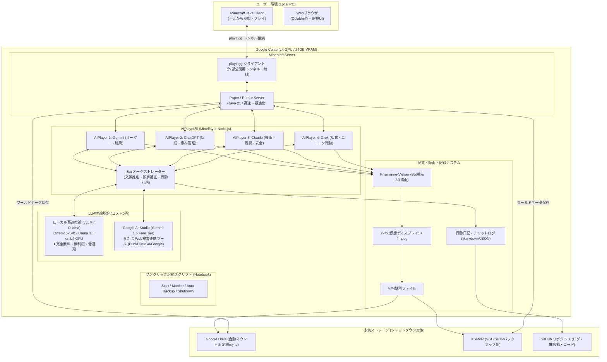

# Minecraft for Colab 開発・実装計画書 (Project Plan)

本ドキュメントは、[Note.html](Note.html) に記載された仕様に基づき、Google Colab上で一時的なMinecraft Java版サーバーを立ち上げ、追加コスト0円でLLMを搭載した複数の自律AIPlayer（Gemini, ChatGPT, Claude, Grok）と日本語チャットしながらサバイバルを進め、録画・データ永続化を行うシステムの実装計画です。

---

## 1. システム全体アーキテクチャ

---

## 2. 要件別ソリューションと技術選定

| 要件項目 | 課題・制約 | 採用ソリューション | 詳細とメリット |
| :--- | :--- | :--- | :--- |
| **LLMコスト0円** | 各社API有料、Google One Ultraの直接API化の困難 | **L4 GPUを活用したローカルLLM (vLLM / Ollama) + Google AI Studio無料枠** | ・Colab L4 (24GB VRAM) なら **Qwen2.5-14B-Instruct** や **Llama-3.1-8B-Instruct** が高速推論可能。 ・API費用0円、呼び出し制限なし。 ・GeminiはGoogle AI Studioの公式無料枠（Free Tier）を利用可能。 |
| **4人のAIPlayer (Gemini, ChatGPT, Claude, Grok)** | 複数モデルの並行利用 | **Mineflayer + キャラクター別プロンプト＆役割分担** | 4つのBotプロセスをNode.js (Mineflayer) で起動。 ・**Gemini**: 全体進行、拠点建築、まとめ役 ・**ChatGPT**: 採掘、クラフト、素材管理 ・**Claude**: 周囲警戒、食料確保、護衛 ・**Grok**: 遠征探索、冒険、おもしろ行動 |
| **手元Minecraftからのアクセス** | ColabはプライベートIPで直接ポート公開不可 | **playit.gg CLI (無料)** | 起動時にCLIで自動トンネル生成。固定ドメインまたは自動生成ドメインで自宅PCから即座に接続可能（ngrokのような帯域制限なし）。 |
| **1回実行で全自動起動** | ユーザー操作を最小限に | **統合Shell/Pythonスクリプト** | 1. 依存関係インストール（Java, Node.js, vLLM, playit.gg） 2. ストレージ復元（ワールドロード） 3. サーバー起動＆トンネル待機 4. LLM起動＆Bot4体ログイン 5. 監視ループ＆自動バックアップ開始 |
| **データ消失防止 (シャットダウン対策)** | Colabランタイム終了時にファイルが消滅 | **Google Drive自動同期 + XServerバックアップ** | ・`google.colab.drive` マウントによる即時保存。 ・5分ごとの自動セーブ＆rsync。 ・XServerのSSH/SFTP同期スクリプトを組み込み、二重化。 |
| **ゲーム画面の視認＆動画収録** | サーバーはCUIで画面描画がない | **Prismarine-viewer + Xvfb + ffmpeg録画** | ・Botの視点をWebGLでレンダリングするPrismarine-viewerを仮想ディスプレイ(Xvfb)で起動。 ・ffmpegで定常録画（MP4）し、Drive/XServerへ保存。 |
| **日本語チャット＆文脈推測・誤字脱字最適化** | ユーザーの意図の汲み取り、誤字脱字 | **文脈管理バッファ + プロンプト最適化** | 直近チャット履歴（発言者、時間、行動）を文脈として保持。「木をとってきて」「あれ作って」等の指示を周辺状況から推測して行動に落とし込む。 |
| **Web検索による最新情報取り入れ** | Minecraftの最新レシピや攻略情報 | **DuckDuckGo / Google Search Tool** | Botが未知のアイテムやクラフトレシピに直面した際、自律的にWeb検索して回答・実行。 |
| **Git自動プッシュ** | 変更ごとのコミット＆プッシュ | **GitHub Action / 自動コミットスクリプト** | プレイ終了時やコード変更時に、ログ・備忘録・更新コードを自動コミット＆プッシュ。 |

---

## 3. 実装フェーズ・ロードマップ

### フェーズ 1: コアサーバー & ネットワーク基盤構築
1. **Minecraft サーバー自動セットアップスクリプト**
   - Paper/Purpur (Java 21) の最新安定版自動ダウンロード。
   - `eula=true`、サーバー最適化設定（メモリ・視界距離・ティックレート）。
2. **playit.gg トンネリング自動接続**
   - トンネルURLの自動取得とColab出力への見やすい表示。
3. **Google Drive / XServer データ永続化エンジン**
   - 起動時のワールド展開（リストア）と定期（5分おき）・終了時の自動アーカイブ（バックアップ）。

### フェーズ 2: ローカルLLM推論基盤 & Web検索の整備 (コスト0円)
1. **L4 GPU 最適化推論環境 (vLLM または Ollama)**
   - 日本語追従性とツール利用（Function Calling）に優れたオープンモデル（例: `Qwen2.5-14B-Instruct-GPTQ-Int4` や `Llama-3.1-8B-Instruct`）をロード。
   - Google AI Studio (Gemini 1.5 Flash/Pro Free Tier) とのフォールバック・ハイブリッド構成。
2. **Web検索連携モジュール**
   - レシピ検索、Wiki参照用の軽量検索API/スクレイパー。

### フェーズ 3: 自律AIPlayer (Mineflayer) システム開発
1. **Mineflayer 4体制御マネージャー**
   - `bot.on('chat')` による日本語対話ルーティング。
   - 移動・ナビゲーション (`mineflayer-pathfinder`)。
   - インベントリ管理、採掘 (`mineflayer-collectblock`)、戦闘 (`mineflayer-pvp`)、食事 (`mineflayer-auto-eat`)。
2. **ペルソナ & 役割プロンプティング**
   - 4人それぞれの個性・口調・行動優先度をシステムプロンプトで定義。
   - ユーザーのチャット履歴・誤字脱字補正・文脈理解エンジン。

### フェーズ 4: 視認・動画収録 & ログ備忘録エンジン
1. **Xvfb + Prismarine-viewer + ffmpeg 自動録画**
   - Bot視点のWeb描画画面をヘッドレスキャプチャし、H.264 MP4として数時間のセッションを分割/一括録画。
2. **プレイ日誌・行動記録の自動生成**
   - チャット履歴、討伐、クラフト、死亡、建築イベントをタイムスタンプ付きでMarkdown形式の日記としてリポジトリに保存。

### フェーズ 5: Colabノートブック統合 & GitHub同期
1. **`Minecraft_Colab_Runner.ipynb` の作成**
   - 「起動」セル1つで全プロセス（サーバー・トンネル・LLM・Bot・録画）が立ち上がる親切なUI。
   - 「シャットダウン＆データ保存」セルの実装。
2. **GitHub 自動コミット＆プッシュスクリプトの整備**。

---

## 4. Colab ノートブックの利用フロー（ユーザー体験イメージ）

1. **Colabを開き、ランタイムを「L4 GPU」に設定**
2. **セル1: 初期設定・認証（初回のみ）**
   - Google Driveマウント または XServer接続設定（SSH鍵/パスワード）
   - GitHubアクセストークンの設定
3. **セル2: 「ワンクリック起動」実行**
   - 画面上に **「Minecraftサーバー接続アドレス: xxx.playit.gg:yyyy」** が大きな文字で表示される。
   - 自宅のMinecraftから接続。
   - サーバーに入ると、すでに4人のAI仲間（Gemini, ChatGPT, Claude, Grok）がスポーンしており、「こんにちは！サバイバル始めましょう！」と日本語でチャットしてくる。
   - 画面裏ではBot視点の録画とログ記録が自動開始。
4. **プレイ終了時**
   - チャットで「バイバイ」「終了するよ」と言うか、Colabの **「シャットダウン」セル** を実行。
   - 自動でワールド保存、動画のDrive/XServerアップロード、行動日誌のGitHubコミットが行われ、安全にセッション終了。
