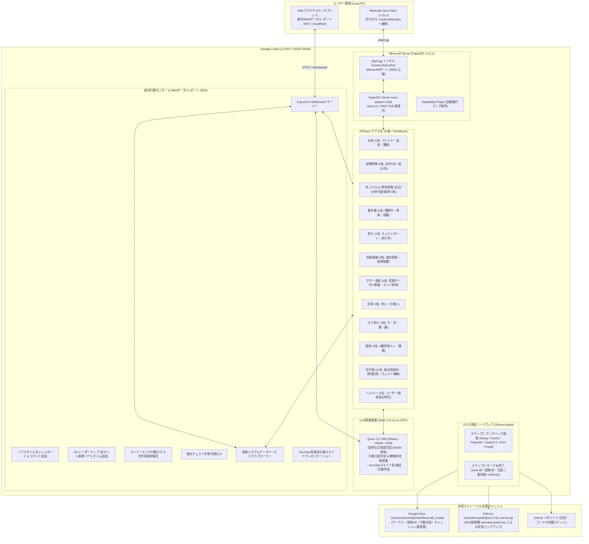

# Minecraft for Colab 開発・実装計画書 (Project Plan v2)

本ドキュメントは、[改善指示書v2.html](改善指示書v2.html) に記載された仕様に基づき、Google Colab（L4 GPU）上で一時的なMinecraft Java版サーバーを立ち上げ、**Qwen 2.5（14B）を頭脳とする全41体の用途別自律AIPlayer** および **総合行動モニターWebポータル** と共にサバイバル生活を進め、データ永続化と統括日報（YouTubeスライド）作成を行うシステムの実装計画です。

---

## 1. システム全体アーキテクチャ

---

## 2. 実装仕様一覧 (改善指示書v2 対応状況)

| 項目 | 要件仕様 | 実装内容 | ステータス |
| :--- | :--- | :--- | :---: |
| **AIPlayer** | 4AI(Gemini, ChatGPT, Claude, Grok)廃止 | `persona.js` にて旧4AIを完全廃止 | ✅ 完了 |
| **AIPlayer** | 用途別41体AIPlayerのスポーン | お供(1), 迎撃(水中1/地上2), 木こり(1), 農作業(1), 資材(5), 釣り(1), 洞窟(3), ネザー(3), 交易(3), 狩猟(4), 飼育(4), 司令塔(11), ヘルパー(1) を定義・実装 | ✅ 完了 |
| **AIPlayer** | 司令塔による資材回収とチェスト格納 | 11名の各司令塔が担当現場AIから資材を回収し、拠点チェストへ格納（空きなし時は床面ドロップ） | ✅ 完了 |
| **AIPlayer** | ネザー遠征 (荒廃ポータル修復) | 動画解析座標 (278, 63, 94) へボートで移動し、ゲート修復・ネザー探索・エンド資材集め | ✅ 完了 |
| **AIPlayer** | サーバー最大参加人数の拡張 | `server.properties` にて `max-players=100` へ引き上げ | ✅ 完了 |
| **推論基盤** | Qwen 2.5 (Colab L4最高スペック) | L4 GPU (24GB VRAM) に最適化された `qwen2.5:14b` をOllamaローカル推論として導入 | ✅ 完了 |
| **記録機能** | 画面収録機能の廃止 | `recorder/` ディレクトリおよびffmpeg/Chrome依存を完全削除 | ✅ 完了 |
| **記録機能** | 行動日誌のLLM学習 & 改善提案 | Qwen 2.5 が全ボット日誌と資材DBを自律分析し、具体的改善提案を出力 | ✅ 完了 |
| **ポータル** | 総合行動モニターWebポータル | ポート3000にExpress/WebSocketによるモダンDark UIポータルを実装 | ✅ 完了 |
| **ポータル** | 10大機能の完全統合 | コマンド送信, チャット, 2Dマップ, 日誌閲覧, 深部DB, ログ, 司令塔報告, チェスト閲覧, 畑牧場モニター, 統括日報 | ✅ 完了 |
| **日報** | YouTubeスライド統括日報 | 起動セッションごとに視覚的日報を作成、YouTubeスライド表示モード搭載 | ✅ 完了 |
| **Colab** | 2セル完結ノートブック | ワンクリック起動セルとセーブ＆終了セルの2つのみに集約 | ✅ 完了 |
| **高速化** | キャッシュ永続化 | Google Driveキャッシュにより2回目以降のモデル・依存ダウンロード時間を削減 | ✅ 完了 |
| **接続** | playit.gg 固定流用 | 既存の `playit.toml` (zuyasi / zuyasi.playit.plus) を完全流用 | ✅ 完了 |

---

## 3. 今後の運用手順

1. Google Colab上で [`Minecraft_Colab_Runner.ipynb`](Minecraft_Colab_Runner.ipynb) を開く。
2. ステップ1（起動セル）を実行し、約45秒〜1分で完了。
3. 表示されたWebポータルURLおよびMinecraftアドレス `zuyasi.playit.plus` から接続・プレイ。
4. 終了時はステップ2（セーブ＆終了セル）を実行。
