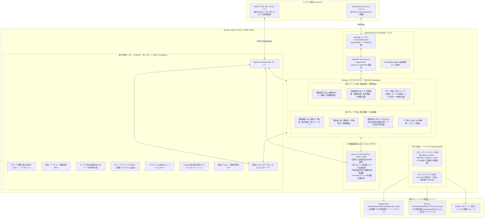

# Minecraft for Colab 開発・実装計画書 (Project Plan v3)

本ドキュメントは、[改善指示書v3.html](改善指示書v3.html) に記載された仕様に基づき、Google Colab（L4 GPU）上で一時的なMinecraft Java版サーバーを立ち上げ、**Qwen 2.5（14B）を頭脳とする2グループ全10名の用途別自律AIPlayer** および **総合行動モニターWebポータル** と共にサバイバル生活を進め、データ永続化と統括日報（YouTubeスライド）作成を行うシステムの実装計画です。

---

## 1. システム全体アーキテクチャ

---

## 2. 実装仕様一覧 (改善指示書v3 対応状況)

| 項目 | 要件仕様 | 実装内容 | ステータス |
| :--- | :--- | :--- | :---: |
| **AIPlayer** | 4AI(Gemini, ChatGPT, Claude, Grok)廃止 | 旧4AIを完全廃止・関連ログもクリーン消去 | ✅ 完了 |
| **AIPlayer** | Qwen 2.5 (Colab L4最高スペック) | L4 GPU (24GB VRAM) に最適化された `qwen2.5:14b` をOllamaローカル推論として導入 | ✅ 完了 |
| **AIPlayer** | 2グループ用途別クラスタ (全10名) | 第1グループ(5名: 撃退, 農作業, 資材集めペア, モブ狩り) / 第2グループ(5名: 飼育, 洞窟発掘ペア, ネザー遠征ペア) を実装 | ✅ 完了 |
| **AIPlayer** | 第1グループ内の会話・一体作業 | 第1グループ所属ボット間で作業進捗・安全確認の会話を自動交わし一体となって作業 | ✅ 完了 |
| **AIPlayer** | 2人ペア間の会話・共同作業 | 資材集め(1&2), 洞窟発掘(1&2), ネザー遠征(1&2) が互いに会話を交わし共同作業 | ✅ 完了 |
| **AIPlayer** | 洞窟発掘・ネザー遠征のAI単独完遂 | 松明配置・鉱脈採掘・廃坑探検、ボート移動・荒廃ポータル(278,63,94)修復・エンド資材回収をAIのみで完遂 | ✅ 完了 |
| **AIPlayer** | 道具・アイテム・食料の要求機能 | 必要なツール・食料が不足した際にプレイヤーへ要求チャットを発言し、ポータルへ通知 | ✅ 完了 |
| **AIPlayer** | 拠点チェストへの納品（満杯時ドロップ） | 収集アイテムを拠点チェストへ自動格納。チェスト満杯時は床面へドロップ納品 | ✅ 完了 |
| **記録機能** | 画面収録機能の廃止 | 録画モジュールおよび関連ログ・映像を完全廃止・削除 | ✅ 完了 |
| **記録機能** | 行動日誌のLLM学習 & 改善提案 | Qwen 2.5 が全ボット日誌と資材DBを自律分析し、具体的改善提案を出力 | ✅ 完了 |
| **ポータル** | 行動モニターWebポータルの新タブ展開 | Colab起動完了時に `window.open` プログラムにより新しいタブで自動展開 | ✅ 完了 |
| **ポータル** | AIPlayerのグループ管理 | 第1グループ・第2グループの一括スポーン/デスポーンおよび個別制御UI | ✅ 完了 |
| **ポータル** | 指示達成状況と報告レポート | 司令等（各グループ統括リーダー）がユーザー指示に対する進捗率・具体的成果をレポート化 | ✅ 完了 |
| **日報** | YouTubeスライド統括日報 | 起動セッションごとに実際の日付に基づき視覚的日報を作成、YouTubeスライド表示モード搭載 | ✅ 完了 |
| **Colab** | 2セル完結ノートブック | ワンクリック起動セルとセーブ＆終了セルの2つのみに集約 | ✅ 完了 |
| **堅牢性** | いつランタイムが切れても安全な設計 | バックグラウンド常駐、5分間隔の自動オートセーブ（Drive/XServer同期） | ✅ 完了 |
| **接続** | playit.gg 固定流用 | 既存の `playit.toml` (zuyasi.playit.plus) を完全流用 | ✅ 完了 |
| **ワールド** | ワールド再生成 & 既存ログ消去 | 起動時に旧ワールドと過去の行動日誌・ログをクリーン削除し再生成 | ✅ 完了 |

---

## 3. 運用手順

1. Google Colab上で [`Minecraft_Colab_Runner.ipynb`](Minecraft_Colab_Runner.ipynb) を開く。
2. ステップ1（起動セル）を実行（約40秒〜1分）。
3. 自動的に新しいタブで開いた **総合行動モニターWebポータル** および Minecraftアドレス **`zuyasi.playit.plus`** から接続・プレイ。
4. ポータル上でグループ管理（第1G/第2Gスポーン）、チャット指示、道具要求の充足確認、YouTubeスライド日報の確認等を実施。
5. 終了時はステップ2（セーブ＆終了セル）を実行。
